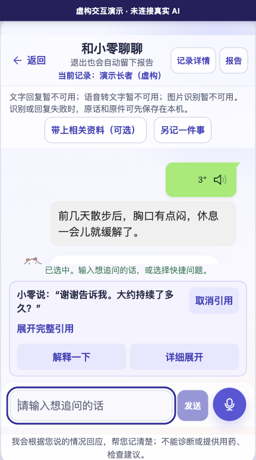
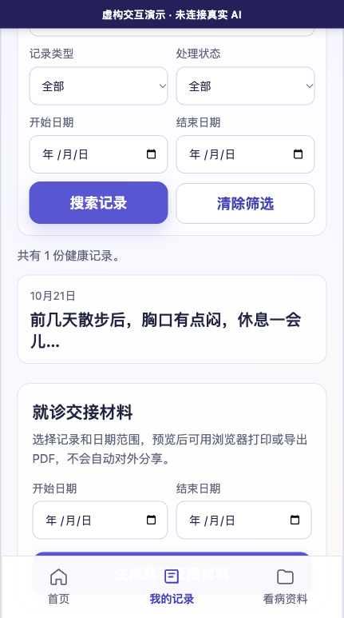

[简体中文](README.md) · [English](README.en.md)

<div align="center">
  
  <h1>NoReset · 病历不归零</h1>
  <p><strong>用语音和文字记下健康变化，下次就诊不用从头讲起。</strong></p>
  <p>持续对话 · 引用追问 · 病历资料整理 · 本机加密保存</p>
  <p><a href="#quick-start">本地运行</a> · <a href="#usage">怎么使用</a> · <a href="#privacy">数据与隐私</a> · <a href="https://github.com/Irixil/NoReset/issues">反馈问题</a></p>
</div>

NoReset 面向想记录自身健康变化的人，也适合帮助家人整理就诊资料的照护者。你可以和「小零」聊聊发生了什么，把录音、文字与已有资料留在一起，再查看带有原话来源的就诊沟通报告。

今天没说完，明天打开同一条记录接着说。新的补充继续进入原对话，同一份报告随记录更新。

<p align="center">
  
  <br><sub>当前界面的交互演示，使用虚构文字和合成音频；展示界面流程，不作为模型准确率证明。</sub>
</p>

## 你可以用它做什么

| 想做的事 | 在 NoReset 中怎么做 |
| --- | --- |
| 把不舒服的经过说清楚 | 打字或录音；语音以可播放的气泡显示，下面保留转写文字，识别成功后继续 AI 对话 |
| 回头问某一句话 | 长按消息，第一项就是「追问」；带着引用打字或录音，也可直接点「解释一下」「详细展开」 |
| 补充前几天的变化 | 在「我的记录」打开原聊天，保留已有对话、录音和报告，继续补充 |
| 改正刚才说错的内容 | 修改最近一条自己的消息，保留修改前的文字；更早的内容通过补充或引用追问说明 |
| 整理照片与病历 | 上传资料照片，识别文字后对照原件核对，再加入记录 |
| 准备看病时要讲的内容 | 查看报告中的经过、已有信息和待补充内容，并回看对应来源 |
| 分别给家人记事 | 切换所属人；各自保存记录与健康背景，按需带上相关资料 |
| 自己管理资料 | 导出加密备份；删除前确认范围，确认后同步清理对应本机记录及关联原件 |

<a id="usage"></a>
## 从第一句话开始

### 1. 建立本机资料库

第一次打开，设置至少 10 位的恢复口令。随后选择本次记录属于自己还是家人。

恢复口令用于解锁资料和恢复备份，请自行妥善保管。换浏览器、换设备时，需要导入备份；资料不会自动同步。

### 2. 像聊天一样说

进入「和小零聊聊」，直接输入一句话，或点麦克风开始录音。

录音时可点「结束这句话」；支持静音检测的浏览器也会在停顿后结束。保存后，聊天中显示这段录音和处理状态。识别文字出现在语音气泡下方，随后显示 AI 回复，无需先勾选确认。

点语音气泡可以播放、暂停原录音。若识别失败，可在原件保存成功后回放或重新处理，页面会显示具体状态。

### 3. 想问哪一句，就引用哪一句

长按自己或小零的消息，选择第一项「追问」。电脑也可右键打开消息菜单。

输入框上方会显示引用内容：可以展开查看、取消引用，或者直接提问。

- **解释一下**：带着这条引用直接发送，请小零换一种说法。
- **详细展开**：带着引用直接发送，继续说明这部分内容。
- **自己问**：输入文字或录音，再发送你的问题。

问题与回复追加在当前聊天底部，不会另开分支或覆盖之前的对话。

<p align="center">
  
  
</p>

### 4. 改正、保存，下次接着聊

最近一条自己的消息可以通过消息菜单修改；已经出现 AI 回复也能修改。更早的消息保留原文，可引用后补充说明，避免改写前文影响后续对话。

记录自动保存在本机。「我的记录」用简短标题和时间展示每件事。点开原记录就回到同一段聊天，跨天也能继续；右上角查看报告，同一份报告持续更新，并保留旧版本和补充日期。

<p align="center">
  
</p>

<p align="center">
  
</p>

### 5. 带上资料，做好备份

在「看病资料」上传照片，保留原件并核对识别文字；在聊天中可选择带上相关资料。健康背景也需由你确认，再决定是否用于后续对话。

在设置中导出 `.bingli` 加密备份。恢复时选择备份文件，输入对应口令，并按页面提示确认恢复。

删除记录时，页面会先显示明显的确认窗口。确认后清理该记录或会话及其关联本机原件，并刷新记录与资料列表。**已经下载到其他位置的旧备份不会随之删除**，需要你自行管理。

<a id="quick-start"></a>
## 本地运行

这是可自行运行的源码项目，界面以简体中文为主。需要 **Python 3.12**；真实对话、语音和照片识别还需配置相应服务的 API 密钥，费用由服务商按用量计算。

```bash
git clone https://github.com/Irixil/NoReset.git
cd NoReset
python3.12 -m venv .venv
source .venv/bin/activate
python -m pip install -r requirements-dev.txt
cp .env.example .env
```

Windows 可使用 `py -3.12 -m venv .venv`，再运行 `.venv\Scripts\Activate.ps1` 激活环境，并复制 `.env.example` 为 `.env`。

在本机 `.env` 中配置密钥：

```dotenv
DEEPSEEK_API_KEY=填入你的对话服务密钥
AIHUBMIX_API_KEY=填入你的语音和图片识别服务密钥
```

按照 `.env.example` 保留或调整模型设置，再检查配置、启动：

```bash
python -m scripts.start_app --check-config
python -m scripts.start_dev
```

打开 **[http://127.0.0.1:5173/](http://127.0.0.1:5173/)**。默认后端端口为 `18768`。麦克风需要浏览器授权；远程访问录音功能需使用安全连接。

更多配置见 [模型连接说明](docs/MODEL-CONNECTION.md)。请勿把 `.env` 或密钥提交到 GitHub。

<a id="privacy"></a>
## 数据与使用边界

- **本机保存**：对话、健康背景和录音照片原件保存在当前浏览器的加密资料库中。清除网站数据前，请先导出备份。
- **在线处理**：使用 AI 时，本轮所需的文字和所选上下文会发送到配置的模型服务；语音、照片识别会发送相应文件。恢复口令不随请求发送。
- **来源可回看**：原话、原件与修改历史用于核对；自动转写不等同于你已经确认，AI 回复也不应当作患者原话。
- **用于记录和沟通**：报告帮助整理就诊信息，不提供诊断、处方或治疗方案，不能代替医生判断。

## 文档与反馈

- [架构与数据流](docs/ARCHITECTURE.md)
- [接口说明](docs/API.md)
- [模型连接与本地配置](docs/MODEL-CONNECTION.md)
- [提交问题或建议](https://github.com/Irixil/NoReset/issues)

反馈时请说明操作步骤、预期结果与实际结果，并使用虚构示例。不要在公开 Issue 中上传真实病历、恢复口令或 API 密钥。

本仓库目前未附通用开源许可证；公开源码不等于授予任意使用、修改或再分发的许可。公开样例的来源与许可见 [data/public_cases/README.md](data/public_cases/README.md)。
