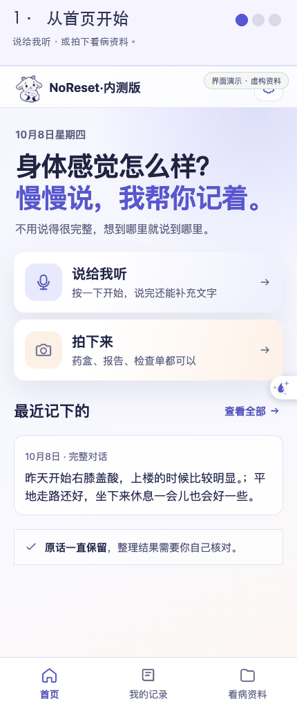
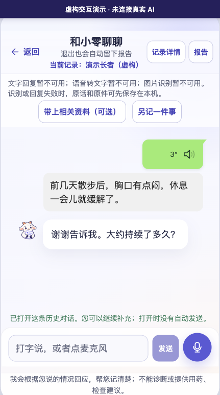
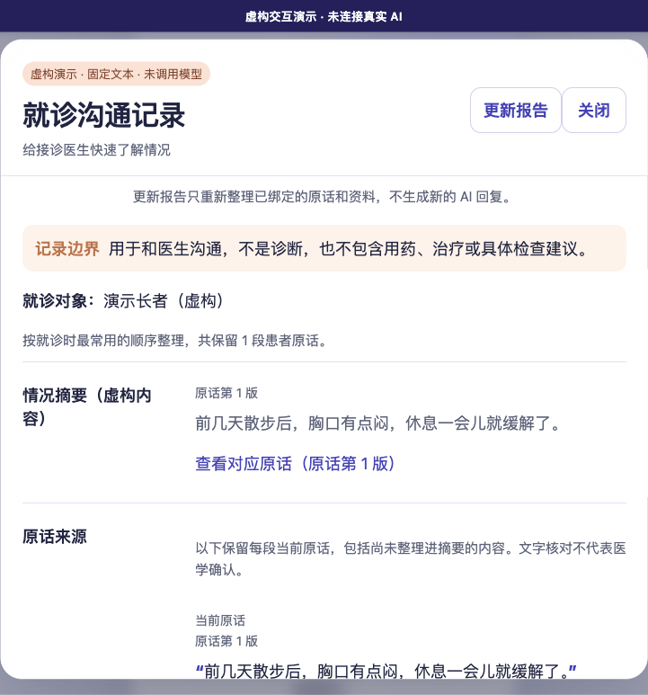
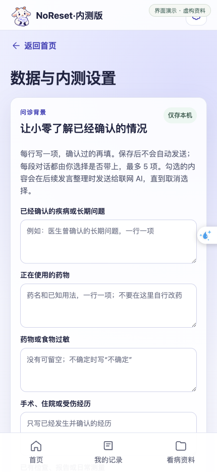
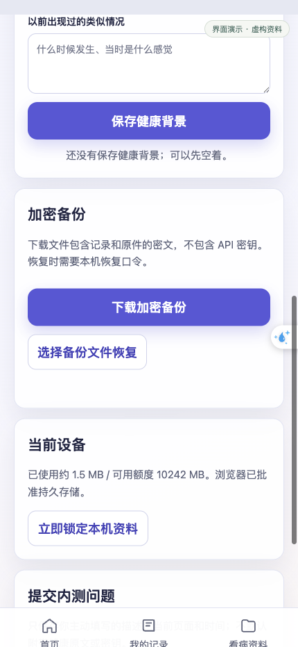

<div align="center">
  
  <h1>NoReset · 病历不归零</h1>
  <p><strong>把这次的不舒服聊清楚，让每一次健康记录都能接着说。</strong></p>
  <p>语音与文字对话 · 看病资料整理 · 就诊沟通记录 · 本机加密保存</p>
  <p><a href="#先看一遍怎么用">看演示</a> · <a href="#它能帮你做什么">看功能</a> · <a href="#第一次使用跟着这四步走">开始使用</a> · <a href="#在自己的电脑上运行">本机安装</a></p>
</div>

---

身体有什么变化，你可以直接说给「小零」听，也可以打字慢慢写。小零会结合你刚才说的话和相关背景回应，必要时再问一个问题，帮助你把情况说清楚。

NoReset 把这些原话、录音和看病资料留在一起。你可以补充、纠正、回头查找，再整理成带有来源的就诊沟通记录，方便自己回顾，也方便向医生说明情况。

适合想少填表、多说话的使用者，也适合陪家人一起整理看病资料的人。

## 先看一遍怎么用

**从首页开始 → 用自己的话聊 → 查看就诊沟通记录。**

<p align="center">
  
</p>

<p align="center"><sub>动图按使用顺序轮播实际界面；配图中的聊天和健康背景均为虚构演示内容。</sub></p>

## 它能帮你做什么

| 你需要做的事 | 可以怎样使用 NoReset |
| --- | --- |
| 把不舒服说清楚 | 用语音或文字连续交流；可以提问、表达担忧、说明没听懂，也可以主动补充。 |
| 改正说错或识别错的内容 | 修改聊天里的原话，更新关联记录，并保留修改版本。 |
| 把检查单、报告和药盒留好 | 拍照或上传原图；识别文字后对照原件核对，再用于整理。 |
| 带上以前的相关情况 | 保存已确认的用药、过敏、既往情况等，每段对话自行勾选相关背景。 |
| 就诊前整理要说的话 | 查看本次沟通记录，或选择历史记录生成就诊交接材料，保留原话和待核实内容。 |
| 过几天继续记录 | 回到未完成的对话继续说；按关键词、类型、状态和日期查找旧记录。 |
| 换设备时带走资料 | 下载加密备份，用对应的恢复口令在新浏览器中恢复。 |

## 第一次使用，跟着这四步走

### 1. 建立自己的记录库

第一次打开，设置一个至少 **10 个字或字符**的恢复口令，再输入一次确认。以后在同一浏览器中，用这个口令解锁资料。

妥善记住口令，并定期下载备份。口令不会上传，忘记后无法由服务器代为找回。

### 2. 点「说给我听」，和小零聊聊

进入首页的 <strong>「说给我听」</strong>，就会看到 <strong>「和小零聊聊」</strong>。

- **想打字**：在输入框写下情况，点「发送」。
- **想说话**：点麦克风，允许浏览器使用麦克风后开始说。说完点「结束这句话」；支持自动结束的浏览器也可以在停顿后结束录音。
- **想带上过去的情况**：点「带上相关资料（可选）」，勾选本次有关的健康背景，最多 5 项。
- **发现文字有误**：点对应原话旁的「修改」，核对后保存。
- **还有补充**：接着说即可；另一件事情可以点「另记一件事」。

比如，从「昨天开始右膝盖酸，上楼时比较明显」说起，再补充平地走路时的感觉和休息后的变化。不需要先想好一套完整答案。

<table>
  <tr>
    <td width="50%" align="center"><strong>按自己的节奏说</strong><br><sub>补充、提问、纠正原话。</sub></td>
    <td width="50%" align="center"><strong>查看整理后的记录</strong><br><sub>原话和待核实内容一起保留。</sub></td>
  </tr>
  <tr>
    <td></td>
    <td></td>
  </tr>
</table>

<p align="center"><sub>点击截图可查看大图。</sub></p>

聊天中的 <strong>「报告」</strong>可以随时查看本次就诊沟通记录。离开后再回来，也可以接着未完成的对话说。

### 3. 拍下资料，对照原件核对

从首页 <strong>「拍下来」</strong>或底部 <strong>「看病资料」</strong>进入，保存检查单、报告、药盒等原图；已有的录音也可以作为资料上传。

识别后，打开原件与文字逐行比对，重点看 **日期、数字、小数点、单位和药名**。看不清或被裁切的地方留待核实，完成原件核对后再用于整理。

如果识别失败，先保留原件，可以从资料页面重试；需要继续交流时，也可以直接输入文字。

### 4. 在「我的记录」中回顾和准备就诊

底部 <strong>「我的记录」</strong>可以搜索旧记录、查看完整对话。选中需要的记录或日期范围，点 <strong>「生成就诊交接材料」</strong>，就能集中查看这次想带给医生的信息。

先核对预览中的原话、时间、来源和待核实事项，再使用浏览器打印或保存为 PDF，自行交给医生。

## 把相关背景留好，下次按需带上

在右上角 **设置**中，保存已经确认的长期问题、正在使用的药物、过敏、手术或住院经历、已有检查，以及过去类似的情况。

这些背景加密保存在本机。每次进入对话，由你选择这次要带上哪些内容；也可以一项不选。选中的背景会随后续发言发送给在线 AI，直到取消选择。

<table>
  <tr>
    <td width="50%" align="center"><strong>保存健康背景</strong><br><sub>确认后填写，对话时按需选择。</sub></td>
    <td width="50%" align="center"><strong>备份自己的记录库</strong><br><sub>换设备或清理浏览器前先下载。</sub></td>
  </tr>
  <tr>
    <td></td>
    <td></td>
  </tr>
</table>

<p align="center"><sub>点击截图可查看大图。</sub></p>

## 备份与恢复

**下载备份**：在设置中点 <strong>「下载加密备份」</strong>，把 `.bingli` 文件保存在自己能找到的位置。文件包含记录和原件的密文，恢复时需要对应口令。

**恢复资料**：新浏览器第一次打开时，选择 <strong>「已有加密备份？从备份恢复」</strong>；也可以使用设置中的恢复入口。选择备份文件，输入那份备份的恢复口令，再按页面提示检查和恢复。

记录保存在 **当前设备的当前浏览器**，不会自动同步到另一台设备。清理浏览器数据或换设备前，请先下载备份；已经下载的旧备份需要自行管理。

## 在自己的电脑上运行

准备 **Python 3.12**，以及自己的 DeepSeek 和 AIHubMix 服务配置。完整应用使用下方指定的整合分支。

### 下载并准备环境

```bash
git clone --branch codex/backend-integration-2026-09-14 https://github.com/Irixil/NoReset.git
cd NoReset
python3.12 -m venv .venv
source .venv/bin/activate
python -m pip install -r requirements-dev.txt
cp .env.example .env
```

<details>
<summary><strong>Windows 用户：用这组环境准备命令</strong></summary>

下载仓库后，在项目目录的 PowerShell 中运行：

```powershell
py -3.12 -m venv .venv
.\.venv\Scripts\Activate.ps1
python -m pip install -r requirements-dev.txt
Copy-Item .env.example .env
```

</details>

### 填写服务配置

打开本机 `.env`，填写自己的密钥：

```dotenv
DEEPSEEK_API_KEY=你的文字对话服务密钥
AIHUBMIX_API_KEY=你的语音与图片识别服务密钥
```

不要把 `.env` 上传到 GitHub。在线对话、转写和识字使用对应服务，费用按服务商规则计算。

### 启动并打开页面

```bash
python -m scripts.start_app --check-config
python -m scripts.start_dev
```

打开 **[http://127.0.0.1:5173/](http://127.0.0.1:5173/)**，按照上面的四步开始使用。

前端默认使用 `5173`，后端默认使用 `18768`。平时打开前端页面即可；两项服务由启动命令一起运行。

## 使用时常见的问题

**一定要用语音吗？**

不用，随时可以打字。使用录音需要浏览器麦克风权限；本机页面或 HTTPS 页面才能使用麦克风。

**没有网络，还能看自己的记录吗？**

可以。本机解锁后可以查看、修改已保存的记录与资料。在线 AI 对话、录音转写和图片识字需要网络和对应服务配置。

**资料会发送给在线 AI 吗？**

健康记录加密保存在本机。使用在线能力时，本轮对话所需的文字、选中的相关背景，以及用于识别的录音或图片，会发送给对应服务。恢复口令不会上传。

**可以用它诊断或决定用药吗？**

NoReset 用于健康记录与就诊沟通。记录核对只确认内容；诊断、治疗和用药决定请交给医生。

## 进一步了解

[模型接入说明](https://github.com/Irixil/NoReset/blob/codex/backend-integration-2026-09-14/docs/MODEL-CONNECTION.md) · [API 文档](https://github.com/Irixil/NoReset/blob/codex/backend-integration-2026-09-14/docs/API.md) · [产品规格](https://github.com/Irixil/NoReset/blob/codex/backend-integration-2026-09-14/docs/sdlc/spec-contextual-dialogue-v10.md)

代码目前未授予通用开源许可证。公开示例资料的独立许可见对应资料说明。
