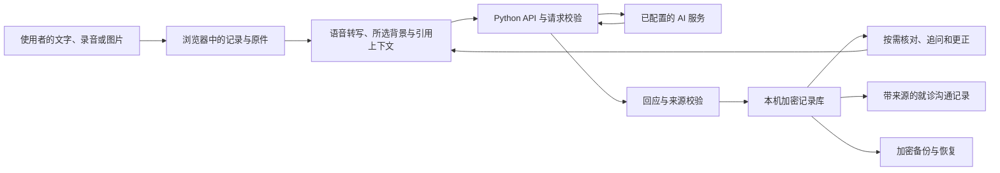

# NoReset 架构与目录

[使用指南](../README.md) · [English guide](../README.en.md) · [API 文档](API.md)

NoReset 采用本地优先的浏览器前端和 Python 后端。前端负责交互、资料核对、记录组织和本机加密保存；后端负责签名会话、受控 AI 请求、来源校验和媒体识别适配。默认本机入口是前端 `5173`，后端 API 是 `18768`。

## 一次记录怎样形成



在线能力会向配置的服务发送本轮所需内容。选择的背景会随之后的发言发送，直到取消选择。加密保存在本机与在线请求是两个不同的数据环节，恢复口令不随 AI 请求上传。

新录音先保存原件，识别成功后直接进入当前对话，不要求先勾选确认。引用消息只提供追问上下文，AI 回复不能成为患者事实来源。历史记录打开后继续原会话；仅最新一条自己的有效消息可编辑。删除经明确确认后同步清理该范围的本机记录与关联原件，旧备份仍由使用者管理。

## 主要目录

| 目录 | 内容 |
| --- | --- |
| `frontend/` | 浏览器界面、会话、资料核对、本机加密存储与缓存。 |
| `backend/` | HTTP API、会话控制、模型和识别适配、安全与来源校验。 |
| `contracts/` | TypeScript API 契约。 |
| `config/` | 结构约束与版本化规则配置。 |
| `prompts/` | 提示词和结构化输出约定。 |
| `scripts/` | 本机启动、离线演示和开发工具。 |
| `tests/` | Python 与 JavaScript 回归检查和虚构夹具。 |
| `data/` | 明确标记的合成样例及带出处、许可的公开样例。 |
| `docs/` | 接口、接入说明和项目文档。 |

前端使用 JavaScript、HTML、CSS 和浏览器 IndexedDB；后端使用 Python 3.12。默认在线配置通过 DeepSeek 处理文字，通过 AIHubMix 处理语音转写和图片识字；适配方式见[模型接入说明](MODEL-CONNECTION.md)。

## 开发检查

安装开发依赖后，从项目根目录执行：

```bash
python -m pytest -q
node --test tests/frontend_*.test.cjs
npm ci
npm run check:contracts
```

需要查看离线合成样例时，可以执行 `python -m scripts.demo --out runtime/demo-result.json`。真实供应商请求需要单独配置服务并承担对应费用；离线演示使用合成数据。

## 数据与用途

健康记录以当前设备、当前浏览器为保存范围，换设备通过加密备份恢复。原件、核对状态、来源和修订用于帮助使用者检查整理后的内容。NoReset 的用途是记录和就诊沟通，诊断与治疗决定由医生负责。

公开源码不包含本机健康资料、恢复口令、API 密钥、内部执行账本或原始测试日志。样例的出处与许可随对应资料保留。
